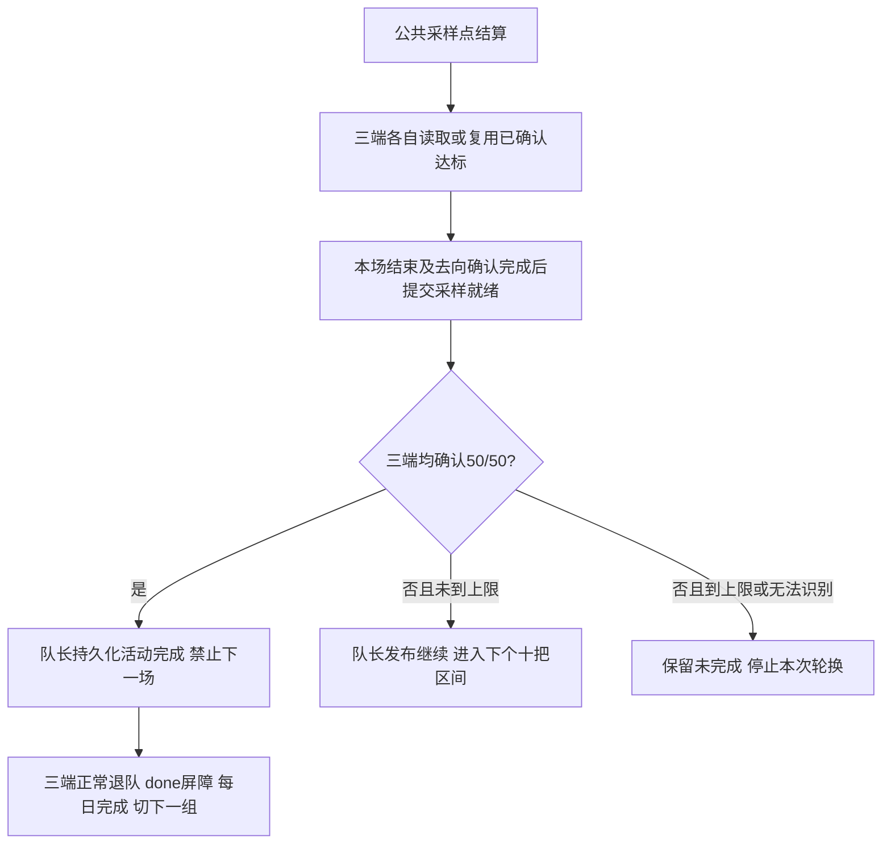

# 组队觉醒活动50/50稀疏OCR设计稿

## 奖励领取页门槛补充（2026-11-11）

用户明确门票显示在领取奖励的袋子页面。采样入口虽然在_handle_reward，仍需I_GET_BATTLE_REWARD或备用袋子模板正向确认；通用page_reward包含其他确认页面，不能单独放行。等待奖励袋时不OCR、不推进奖励空白，最多30秒，奖励袋连续可见至少1秒后再采样；皮肤确认先关闭、再用新帧识别。第200/210/.../250规则、ROI及严格三端50/50门槛保持。

若读不到完整n/50，保存当时原帧、实际ROI裁图与原始读值供核对；没有现场图像时不猜测OCR误读原因，也不把已确认199改成200。运行中范围配置须经当前后端缓存与磁盘一致核验，并一起重载三端任务。

状态：2026-11-11已按用户立即使用要求接入并配置三端，离线验证完成，真实OCR与长跑待验。第200把开始，每10把识别（200/210/.../250，共6点），三端均50/50才完成。正式“每日任务日志”下已有“超鬼王门票情况”HTML入口。本稿保留设计说明，当前实现与部署结果以末尾记录及AI_CONTEXT最新条目为准，不代表现场速度已验证。

## 1. 用户可见行为

| 阶段 | 行为 |
|---|---|
| 第1～199把 | 原组队觉醒流程，不读取活动进度 |
| 第200/210/220/230/240/250把 | 未达标账号分别OCR右上角；同组只在这些采样点等待结果齐全 |
| 一个账号确认50/50 | 保存达标，后续免OCR，继续开战或接受邀请陪跑，不单独退队 |
| 三个账号均确认50/50 | 队长发布活动完成，禁止下一场；三端结束本场结算并正常退队，再切下一组 |
| 250把仍有账号未确认达标 | 不再开战，保存未完成及错误，停止本次任务轮换并通知（通知须已配置），不自动跳组或追加刷场 |

250是保护上限，不是完成目标；200和10只决定何时读取画面。活动完成只采信三端真实读值，不能由刷场次数或耗时推断。第200把之前已经达标也不会提前发现；之后可能因10把采样间隔多刷少量场次。

## 2. 独立活动模式与配置

- 在MultiAccountEvo内新增活动进度模式，普通次数模式保持原行为，不新建第二套战斗或邀请实现。建议字段：活动模式开关、首次OCR场数200、OCR间隔10；沿用本任务battle_count=250作为活动模式保护上限，活动目标固定50。
- 三端配置必须完全一致；模式、目标、采样参数、账号/角色/区服/平台顺序、副本均加入运行身份摘要。启动前继续核对进程内存与磁盘配置，三端一起重载，不允许旧模式进程混跑。
- 活动模式不继承普通EvoZone的30分钟累计运行上限，以三端50/50或250把保护收口；原切号、邀请、未知页面、单场战斗、OCR、同步及恢复的局部超时保留。普通觉醒的时限不变，不任意扩大同步等待或恢复预算。
- 已按原配置锁和原子写入流程备份并配置三端，只修改活动开关、首次OCR200、间隔10、上限250；旧状态和其他配置保留。模板默认关闭，普通次数模式仍可使用。

## 3. 场次、采样轴与恢复

- 继续保存各端真实已确认结算场数，与活动数值分开。不能将开战时增加的current_count当作已完成场次，也不能把它强行设成250来退出。
- 每次执行段在原共享锁内冻结三端起点与统一公共起点，按既有最低确认数安排公共采样轴；恢复后三端共用同一计划，不能各按自己重置后的局部次数决定采样。
- 例如三端均已确认205把，恢复后第5把在公共210点采样，不再等本次运行200把；210/209/210的差额由已有陪跑原则处理，同一公共采样点仍绑定同一执行段及场次，避免三端相互等错轮。
- 不增加每场全员屏障；采样点在执行段开始就确定，队长到该点后不得开下一场，成员在同一场结算采样。平常保留原房间人数与开战正向确认。
- 到达任一端已确认250把时，禁止新开战并对尚未达标端进行本场终局核验。正常无差额时就是第250采样点；恢复导致差额时宁可在上限处终止，不能为了凑齐落后端而让领先端超过已确认保护上限。中断时尚未落盘的场次仍可能重复，不承诺真实消耗精确等于250。
- 已完成的采样点、各端达标标记及待处理点均持久化。恢复清理旧执行段临时报告，但保留绑定正确日期与账号的有效达标；错过截图的未决点在恢复后首个可识别奖励页补采，不再额外等10把，且仍不越过保护上限。

## 4. OCR放在哪里

现有逐场检查点在原战斗返回后保存，此时奖励页可能已经关闭。因此OCR不能只加在该检查点之后，必须接入本任务的奖励页处理器：

1. 新帧明确识别为奖励页；先按原逻辑处理遮挡的已知邀请/活动覆盖层，每步动作后重新截图。仅邀请弹窗不算活动奖励证据。
2. 当前场不是采样场，或该端已确认达标：直接走原结算点击，不发OCR。
3. 当前场需要采样：在首次结算推进点击前，复用现有截图裁取ROI `(1128,10,104,24)`，使用已审阅的 `o_event_progress_50`（Single/Default）。同一场多次奖励页命中不重复发正常请求。
4. 严格解析完整的 `当前值/50`，只接受0～50且分母恰为50的整数读值；允许空白/全角符号规范化，不猜测缺失字符，不将字母O强改为数字0。
5. 普通合法读值读一次即可；首次出现50/50时，保留奖励页，再取一个独立新帧复核。两帧均50/50才锁定达标；同一张图重读不算独立复核。
6. 解析失败、ROI未就绪或复核不一致时做有限新帧重试，每个未达标账号每采样点最多3次OCR（包含50复核）；持续失败保存现场并停止，不能写成达标或无限重试。若得到合法的未满读值，则保守记未达标；已确认达标后不再由后续低置信度结果撤销。
7. 读取后继续原结算；原战斗正常返回，保存真实场次并完成原去向确认后，再确认本场采样已完成。不能因OCR结果先到就跳过本场战斗/结算收尾。

首版建议在采样点同步读取，各OAS进程各读自己的截图，由原OCR服务调度，不新建后台线程或改模型/工作进程数。只阻塞最多6个正常采样点，未达标端每点通常一次；50/50复核与失败重试另计，实际耗时须测量。

容量边界：按此前自然日志相邻开战中位约20.4秒粗算，单组200把约68分钟、250把约85分钟；20组约22.7～28.3小时，尚未包含切号、建房及恢复。稀疏OCR减少识别负担，但不能保证最坏250把的全部20组在24小时内完成；实际以活动期间阵容与运行采样为准。

## 5. 三端同步与自动完成判据

- 三端分别维护 `last_value`、原始文本、已确认达标、采样点、本场就绪及更新时间。达标50与整个角色done不同；队长自己50也必须继续带队，队员50也必须继续跟队。
- 采样报告绑定日期、账号身份、组、run_id、epoch和sample_id，锁内幂等合并；旧报告不得影响新组、新日期或新执行段。
- 队长必须收齐三端本场安全就绪报告才可决策；已达标端可复用有效达标证据而免新OCR，但不能免除本场安全就绪。尚在本场结算的达标端必须等待收尾，不能只凭旧达标标记推断已经退队。
- 采样报告缺失、OCR失败、写盘失败均不得开下一场来绕过；同步等待使用原有有限期限并保留人工失败出口。OCR请求沿用原有限等待，不扩大服务级超时，底层阻塞返回后才能检查期限时不声称严格墙钟中止。
- `run_embedded`返回、各端done、同步advance及每日completed在活动模式下统一检查“全员达标且收尾完成”，不再要求刷满250；250未达标必须失败。次数模式继续使用原计数条件。

## 6. 状态、每日记录与旧数据隔离

- 建议活动模式使用独立同步文件 `config/.multi_account_evo_event_50_sync.json` 及对应锁，复用现有同步类与原子写入，不复制同步实现。保留旧普通次数同步文件和每日记录，不静默迁移旧模式计数。
- 每日任务使用独立活动键（例如 `multi_account_evo_event_50`），不能因今天普通15/200次觉醒已completed而跳过活动。活动身份及采样策略另行绑定，已有不匹配断点须明确处理，不自动清除。
- 原 `DailyStateManager.update_team_progress` 会在progress达到target时自动记完成，活动流程不得把250把传入该完成判据。每日活动完成只能由队长在全员50且done屏障通过后显式写入，再advance；中断后可用持久事件完成事实补齐提交，不重刷。
- 断点保存真实刷场、待处理采样点、各端读值/达标与停止原因。HTML按下节展示门票数与已确认场数；组开始、每10把轻量刷新、采样、恢复、异常和完成时更新，不增加OCR，也不每场重渲染整份协作日报。
- 达标记录不跨日期、账号或活动身份复用。跨日期运行时在安全结算边界停止旧日执行并保留记录，不把旧日50写入新日；不自动对新日账号清进度或重新开始250把。旧JSON没有OCR证据不能反推出50；独立活动模式不自动迁移旧次数记录或清旧状态，如需迁移/重置则作为另项明确操作处理，本轮不做。

## 6.1 每日超鬼王门票HTML日志

### 入口与文件

- 已只读核实桌面 `每日任务日志.url` 指向 `log/dailytask/index.html?open=latest`，现有index会自动跳到最新每日任务HTML。保留该快捷方式与原跳转，不新增桌面快捷方式。
- 在实际打开的每日任务HTML正文下方新增卡片，标题为“超鬼王门票情况”，按钮为“打开每日超鬼王门票刷取情况”。不能只改会被自动跳过的index页。
- 新子页标题“每日超鬼王门票刷取情况”，建议文件为 `log/dailytask/OAS超鬼王门票刷取情况_YYYY-MM-DD.html`，与同一天日报互相链接；查看历史日报时链接其对应日期，不误跳今天。子页提供“返回每日任务日志”和“近7天日志”。
- 近7天index也增加独立门票入口/历史列表，原`open=latest`仍只选择每日任务报告；不让门票HTML抢走桌面默认打开目标。

### 页面内容

| 区域 | 显示内容 |
|---|---|
| 页首 | 日期、更新时间、已确认全员达标组数、当前组、规则200起每10把/上限250 |
| 分组表格 | 组号、三端内部账号/角色、各端最后真实门票值、各端已确认刷场数、组状态、最后更新时间 |
| 单号状态 | 未采集、等待下一次OCR、已确认50/50继续陪跑、OCR失败等；未读取显示“未采集”，不显示伪造0/50 |
| 分组状态 | 待运行、刷取中、采样中、恢复中、三端已达标、到上限未达标、识别/运行失败 |
| 展开采样记录 | 200/210/...采样点、三端原始识别文本与合法值、复核结果、OCR耗时、时间及错误；只记录真实产生的条目 |
| 异常详情 | 哪个实例/账号未达标或识别失败、最后合法值、停止原因；失败不以红字外观代替实际状态 |

- 真实票数和三端达标状态来自活动同步记录，不能用250把或普通觉醒completed填充。尚未采集时可以生成空状态页，不初始化或改写自动任务状态。
- 保留日报现有勾选、图片、浏览器localStorage和导出功能；门票页是自动采集的只读展示，不提供人工勾选来改写50/50判据。
- 页面显示的是最后持久化快照，标明更新时间；运行中刷新页面查看最新文件。首版不另起HTTP服务或后台轮询设备。

### 更新、锁与保留

- 实现独立门票HTML渲染器/写入器，复用既有报告目录、临时文件/fsync/原子替换与进程锁风格。三端写入活动状态并释放状态锁后，报告锁内重读匹配日期/身份的最新状态，避免旧快照覆盖晚到端结果和锁反向嵌套。
- 组开始、每10把及采样/恢复/失败/完成更新门票子页；不为显示票数额外OCR，不触发整份带协作图片日报的每场重建。入口卡片由原日报渲染器生成，门票更新时也能维护归档入口。
- 报告写入失败仅记录展示层异常，不能改写真实达标或触发游戏重启；真实活动状态持久化失败仍按原原则停止。报告路径/日期以保存的运行日期为准，不用过午夜后的当前时间把旧日数据写进新日报。
- 沿用近7个日历日保留规则；扩展明确的门票文件名白名单，按日期各自展示与清理，不递归、不跟随链接、不清配置/断点及其他文件。先原子更新index再清理到期日志；历史HTML保留其当日身份/读数，不用当前账号配置重写历史。
- 旧日报没有门票卡片时，只补导航并保留原勾选/截图内容，或等原日报自然刷新；不重构历史结果。日志目录外的下载副本保留采样内容，导航提供返回原日志目录入口，避免相对链接失效后误认为记录丢失。

此前预览在 `.tmp/multi-account-evo-event-report-design-20261111/html-preview/`。本轮正式报告已在 `log/dailytask/` 生成，日报正文插入入口，桌面快捷方式未改；尚未启动任务，所以票数显示未采集，不预造活动进度。

## 7. 失败时怎样处理

用户明确确认某组已刷完时，可作为一次性人工完成来源：原锁内备份并只标记指定组，写入当日user_confirmed及人工时间；保留实际票数、采样和场数，不补造50/50。HTML显示人工确认完成；必要时推进当前组并使旧执行段失效，重启后从下一组继续。该来源不跨日复用，也不扩大为其他组的自动规则，自动流程仍只认三端真实50/50。

| 情况 | 处理 |
|---|---|
| 队长50，队员49/50 | 整组继续，队长免OCR，未达标端到下个采样点再读 |
| 新活动弹窗挡住数字 | 先按可识别的原结算路径关闭，再新帧识别；未清除不猜数 |
| 一端OCR空白/错误/服务不可用 | 有限重试；持续失败保留未完成，沿现有失败/恢复边界停止，不无限新建恢复 |
| 结算后丢房 | 已结算场次与有效OCR证据保留，未完成采样屏障由原组恢复处理；同日恢复预算仍为一次 |
| 250点仍有49/50或未知 | 停止当前组及本次轮换，保留未完成，报告三端最后读值，不切下一组 |
| 持久化失败 | 停止，不开下一场、不自动重启游戏绕过 |
| 三端均50但完成写入中断 | 重启后核对有效活动断点，补齐安全收尾/完成提交，不重刷200把 |

## 8. 实现与验收顺序

1. 纯组件：采样计划、严格解析、达标复核状态、身份绑定及恢复后计划；不得依赖设备。
2. 临时共享文件与三线程集成：迟到报告、领先端陪跑、采样点屏障、250保护、跨恢复/跨日、旧模式隔离及写盘失败。
3. 接入任务局部奖励页和原战斗循环，活动模式统一完成门槛；保留原点击节奏、两帧回房和开战正向确认。普通模式和前两轮截图/断点优化继续回归。
4. 接入独立门票HTML、日报下方卡片及双类别归档；验证旧勾选/截图、同日链接、未知值展示、并发晚到结果、原子写失败及7天清理白名单。相关测试、toolkit compileall、全量与基线对照、增量空白检查；不声称既有非绿基线已全绿。
5. 用户授权维护窗口后再部署三端设置并进行Level C：真实0/50、两位数、49/50、50/50，奖励弹窗、最后一场、慢队员、OCR服务繁忙、已达标队长继续带队、250未达标和断点恢复。不得为验证擅自启动设备或服务。

实施结果：已接入现有MultiAccountEvo及正式报告，三端参数部署至250/200/10；备份 `config/.event_mode_backup_20261111_110531_261099/`。需重启OAS加载配置模型与脚本，再运行三端组队觉醒。19项门票专项及编译通过；全量2523项仍含既有失败和一项已知同步时序波动，整类9项复跑通过，详见AI_CONTEXT。不启动设备/游戏/OCR，不改旧进度，尚无真实识别准确率或现场速度结论。
